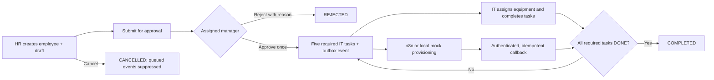

# Employee onboarding and IT asset management

FlowOps remains a Python 3.13 / FastAPI modular monolith with SQLAlchemy 2, PostgreSQL in Compose, SQLite for local development and Jinja2 with local CSS/JavaScript. The existing ticket, checklist, workflow job, audit logging, signed browser session, and notification-outbox code remains in place. The workforce domain is separate from the older onboarding/offboarding checklist API because that API models IT action steps rather than employee and manager approval records.

## Local setup

For a quick SQLite run:

```bash
python -m venv .venv
source .venv/bin/activate
pip install -r requirements.txt
python -m alembic upgrade head
python -m src.workforce_demo
uvicorn src.api:app --reload
```

Open `http://127.0.0.1:8000/workforce/ui`. Swagger is at `/docs`. PostgreSQL setup remains the existing `docker compose up -d --build`; the app migrates on startup and starts `workforce-outbox` with the existing services. Set the integration variables from `.env.example` only when configuring n8n. Local simulated provisioning needs no credentials. `python -m src.workforce_worker` can run the worker by itself for SQLite; Compose runs it continuously.

The seed is safe to run repeatedly and creates synthetic `.test` email records: employee `DEMO-1001`, a draft onboarding request, and available asset `DEMO-LAPTOP-001`. The seeded manager subject is `manager-demo`.

### Role accounts

API role checks accept `HR`, `MANAGER`, and `IT_ADMIN` JWT roles or signed UI sessions. Managers can only access requests and audit data associated with employees whose `manager_subject` equals their authenticated subject. `automation.admin` retains access to existing operator tools during this incremental migration.

To run role-specific UI sessions, enable both auth flags in a development environment and configure `FLOWOPS_SESSION_SECRET`, `FLOWOPS_DEV_BEARER_TOKEN`, and `FLOWOPS_DEMO_USERS`. Generate password hashes with:

```bash
python -m src.demo_users hash
```

The command prompts for a username, role, and password, then prints a PBKDF2 hash snippet. Combine snippets in `FLOWOPS_DEMO_USERS` for HR, manager, and IT_ADMIN. Demo accounts work only when `FLOWOPS_ENVIRONMENT=development`; never use them in production. Production should use Entra bearer authentication with the matching application roles and secure session settings.

## Workflow and states



States are `DRAFT`, `PENDING_APPROVAL`, `IN_PROGRESS`, `COMPLETED`, `REJECTED`, and `CANCELLED`. `APPROVED` is transient in the approval transaction; after tasks are created, the request enters `IN_PROGRESS`. Rejected and completed requests are terminal. HR can copy a rejected request into a new draft. Cancellation suppresses queued events and callbacks reject cancelled requests. Cancellation cannot recall n8n work already in progress, but a late callback cannot change FlowOps state.

Approval and task creation occur in one transaction. A unique `(request_id, task_key)` constraint prevents duplicate task sets; one decision per request is enforced by a unique constraint. The required tasks are Prepare laptop, Assign equipment, Simulate account provisioning, Confirm software setup, and Complete IT orientation checklist. Only required tasks gate completion.

Asset claims use a conditional database update from `AVAILABLE` with no current employee to `ASSIGNED`. One competing claim can succeed. Returning closes the assignment-history row and makes the asset available. Assigned assets must be returned before entering maintenance or retired status.

## API

All routes live under `/workforce` and appear in FastAPI's OpenAPI document at `/docs`.

| Action | Route | Role / credential |
|---|---|---|
| Employee list/create/edit/status | `GET/POST /employees`, `PATCH /employees/{id}`, `PATCH /employees/{id}/status` | HR; IT_ADMIN can list |
| Create/edit/submit/cancel/copy draft | `/onboarding-requests` and action routes | HR |
| List/detail/approve/reject | `/onboarding-requests`, `/{id}` | Assigned manager can read/decide only their requests; HR/IT_ADMIN can read all |
| Filter/update tasks | `GET /tasks?status=&assignee=&overdue=&offset=&limit=`, `PATCH /tasks/{id}` | HR can list; IT_ADMIN can update |
| Inventory/status/assignment/return/history | `/assets` and `/assets/{id}/...` | IT_ADMIN |
| Dashboard and audit | `/dashboard`, `/audit` | Role scoped; manager data is filtered |
| Automation event history/manual retry | `/automation/events`, `/automation/events/{eventId}/retry` | IT_ADMIN |
| Get overdue tasks | `GET /integration/overdue-tasks` | `X-FlowOps-Automation-Key` |
| Record reminder or error outcome | `POST /integration/reminders`, `/integration/errors` | `X-FlowOps-Automation-Key` |
| Provisioning callback/mock | `POST /automation/callbacks/provisioning`; development-only `/automation/events/{eventId}/simulate` | Dedicated callback key / IT_ADMIN |

Pagination is bounded (lists at most 100; audit at most 200). Duplicate employee identifiers/emails and conflicting asset claims return 409. Rejection requires a nonblank reason. Backend role checks are the access boundary; UI controls only improve usability.

## Automation and event delivery

Approval writes a stable event row in the same transaction as the decision and required tasks. The event envelope is:

```json
{
  "eventId": "stable-uuid",
  "eventType": "workforce.onboarding.approved",
  "schemaVersion": "1.0",
  "occurredAt": "2026-10-22T00:00:00+00:00",
  "correlationId": "request-correlation-id",
  "data": {"requestId": 1, "employeeId": 1, "employeeNumber": "DEMO-1001", "workEmail": "avery.santos@example.test", "fullName": "Avery Santos", "startDate": "2026-11-21"}
}
```

The outbox worker leases due events, signs the exact JSON bytes with HMAC-SHA256 (`X-FlowOps-Signature: sha256=...`), and sends the configured production Webhook URL with the automation API key. It retries temporary failures up to five attempts with capped exponential delay. Exhausted events remain visible and can be retried. Delivery state means n8n accepted the webhook; `workflow_status` stays `WAITING` until the authenticated callback records the outcome. Stable event IDs make duplicate callback processing safe.

`FLOWOPS_AUTOMATION_ADAPTER=simulated` completes the account-provisioning task with an explicit simulated note. It creates no external account. n8n mode requires `FLOWOPS_N8N_WEBHOOK_URL`, `FLOWOPS_N8N_WEBHOOK_SECRET`, `FLOWOPS_N8N_API_KEY`, and `FLOWOPS_AUTOMATION_CALLBACK_SECRET`; use unique random values stored in environment or a secret manager.

The importable workflows in `n8n/workflows/` cover approved onboarding provisioning, daily overdue-task reminders, and n8n execution errors. They are inactive exports with URL and credential placeholders. Configure Header Auth credentials (API key for FlowOps integration endpoints and event ingress; separate callback key for provisioning), set the FlowOps base URL, and set an approved operations-notification webhook URL in the error workflow before activation. The reminder outcome is `SIMULATED`, uses a stable task-and-UTC-day event ID, and does not message employees by default. Authoritative business changes remain behind FlowOps APIs.

The exports target n8n **2.44.5 stable**, checked against the official release list on 2026-10-22. They use built-in Webhook, Schedule Trigger, Code, HTTP Request, and Error Trigger nodes. Refer to [n8n Webhook documentation](https://docs.n8n.io/integrations/builtin/core-nodes/n8n-nodes-base.webhook/) and [official releases](https://github.com/n8n-io/n8n/releases) when importing into a later version. No live n8n cloud instance was available, so live execution is unverified.

In n8n choose **Workflows → Import from File** for each JSON export. Configure credentials and placeholder URLs, test using the Webhook test URL, then publish the workflow and configure FlowOps with the production URL. Avoid using the n8n editor URL as the Webhook URL.

## Five-minute portfolio demonstration

1. Run the app, worker, and `python -m src.workforce_demo`; open `/workforce/ui`.
2. Create a synthetic employee and start onboarding, or use `DEMO-1001`; submit its draft.
3. Sign in as its manager (`manager-demo` for the seed), approve, and open the request detail. Confirm exactly five tasks and an outbox event.
4. As IT_ADMIN, assign `DEMO-LAPTOP-001`, complete the hardware, equipment, software, and orientation tasks, then run mock provisioning.
5. Confirm the request becomes COMPLETED only after all five required tasks finish. Show the asset history and audit page.
6. For reliability, configure a test n8n endpoint to fail once, inspect the retry count, restore it, and confirm one stable event ID. Automated tests cover this offline; that is not a live n8n execution.

## Limitations and next steps

- Seed data, account provisioning, and reminders are synthetic/mock. n8n cloud was not available for live verification.
- Production role issuance must be configured in Entra for HR, MANAGER, and IT_ADMIN. Demo users only operate in development.
- Workforce records currently have no tenant key; extend tenant scoping before using this module across MSP clients.
- Bulk HR imports, asset depreciation, and real identity provisioning are possible follow-up work.
